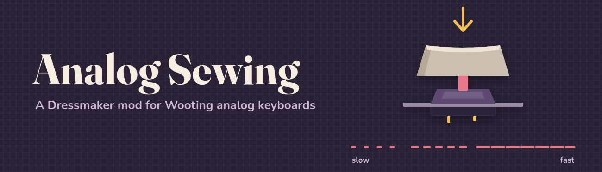

# Analog Sewing for Dressmaker

Use a Wooting (or other Hall-effect analog) keyboard like a sewing machine foot pedal:
press the sew key lightly to sew slowly, press harder to sew faster.

**[Download on Nexus Mods](https://www.nexusmods.com/dressmaker/mods/516)** · **[Watch the showcase](https://www.youtube.com/watch?v=X7dF8f1Ku4E)**

A [BepInEx 5](https://github.com/BepInEx/BepInEx) mod for
[Dressmaker](https://store.steampowered.com/app/4019220/). It reads key depth with
Wooting's official [Analog SDK](https://github.com/WootingKb/wooting-analog-sdk), which is
built in, so there's nothing else to install. Works on its own or with
[Yuuma's Dressmaker ModLoader](https://www.nexusmods.com/dressmaker/mods/1).

## Install

**With Yuuma's Dressmaker ModLoader:** in the game, open Options > Mod Manager > Install/Update
Mod, choose `AnalogSewing-<version>.zip`, and restart Dressmaker.

**Without it:**

1. Install **BepInEx 5 (x64)** into the Dressmaker folder (the one containing `Dressmaker.exe`):
   extract [BepInEx_win_x64_5.4.23.5.zip](https://github.com/BepInEx/BepInEx/releases/tag/v5.4.23.5)
   there. Use 5.4.23.5 or newer: the older BepInEx on Nexus doesn't work with this game.
2. Extract `AnalogSewing-<version>.zip` into the same folder, so you end up with
   `BepInEx/plugins/AnalogSewing.dll`.
3. **Linux / Steam Deck (Proton) only:** set the game's Steam launch options to
   `WINEDLLOVERRIDES="winhttp=n,b" %command%` so BepInEx loads.

Launch the game and sew with Space. `BepInEx/LogOutput.log` should say
`Reading key depth from the Wooting Analog SDK`.

**Updating from 1.0.0:** 1.0.0 installed into a folder; since 1.1.0 the mod is the single file
`BepInEx/plugins/AnalogSewing.dll`. After installing the new version either way, delete
`AnalogSewing.dll` and `wooting_analog_sdk_dist.dll` from `BepInEx/plugins/AnalogSewing/`. (The
newer version loads anyway, and the log reminds you while the old files are there.)

## How it works

- While Space is held past **StartDepthMm**, the machine sews. Speed rises from
  **MinSpeedPercent** to **MaxSpeedPercent** as you press towards **FullSpeedDepthMm**.
- The mod decides when Space counts as pressed, so your keyboard's actuation point and
  Rapid Trigger settings for Space don't matter.
- Right-click sewing, the speed slider and W/S work as normal. If no analog keyboard is
  found, the game plays exactly as it does without the mod.

## Configuration

Change settings in-game in the ModLoader's Mod Settings window (Analog Sewing tab) or with
[BepInEx.ConfigurationManager](https://github.com/BepInEx/BepInEx.ConfigurationManager) (F1), or
edit `BepInEx/config/xamspanda.dressmaker.analogsewing.cfg` (created on first launch).

| Setting | Default | What it does |
|---|---|---|
| `Sewing.StartDepthMm` | 0.4 | How far to press before the machine starts (at minimum speed) |
| `Sewing.FullSpeedDepthMm` | 3.6 | How far to press for maximum speed |
| `Sewing.MinSpeedPercent` | 5 | Speed at the start depth, as % of the game's maximum |
| `Sewing.MaxSpeedPercent` | 100 | Speed at the full-speed depth |
| `Sewing.Curve` | 1.5 | 1 = linear; higher = finer control at low speed |
| `Input.SewKey` | Space | Analog key to sew with (`Space`, `F`, `LeftShift`, `0x2C`, ...); not used with the ModLoader |
| `Advanced.KeyTravelMm` | 4.0 | Your switches' total travel |
| `Display.MoveSpeedSlider` | true | Move the in-game speed slider to show the current speed |

If you pick a `SewKey` other than Space, Space keeps working as a normal sew key at the
slider's speed.

## With Yuuma's Dressmaker ModLoader

- The analog key is whatever keyboard key you bind to **Sew** in Mod Settings > Keybinds
  (Space by default); rebinding takes effect immediately. Mouse buttons bound to Sew sew at the
  slider's speed. If no keyboard key is bound, analog sewing is off.
- Settings are in Mod Settings > Analog Sewing.
- The analog key doesn't sew while you're typing in a text field, setting a keybind, or using
  the loader's debug console.
- The Mod Manager shows the mod's icon, author and credits.

## Troubleshooting

- **Log says "No analog keyboard found":** check the keyboard is plugged in, then restart
  the game. The log line above it shows how many devices the SDK found at startup.
- **Linux/Proton can't see the keyboard:** make sure your user can read the keyboard's
  `/dev/hidraw*` devices (the same udev rules Wootility needs on Linux).
- **Nothing in the log from Analog Sewing:** BepInEx isn't loading; on Proton check the
  `winhttp` launch option.

## Building

Requires the .NET SDK and an installed copy of Dressmaker with BepInEx (the game's
assemblies can't be redistributed, so the build references your copy).

    export DRESSMAKER_DIR=/path/to/Dressmaker    # folder containing Dressmaker.exe
    scripts/install-dev.sh                       # build, package, and install into the game
    scripts/package.sh                           # just build release zips into dist/

`package.sh` downloads the pinned Wooting SDK release, verifies its checksum, and embeds it in
`AnalogSewing.dll` (unpacked to `BepInEx/cache/AnalogSewing/` at runtime), so the release is a
single DLL. Build with these scripts rather than `dotnet build` alone, which can't fetch the SDK.
Page images and the icon come from `docs/media/make_media.py`.

## Credits

- [Wooting Analog SDK](https://github.com/WootingKb/wooting-analog-sdk) (MPL-2.0), see
  [THIRD_PARTY_NOTICES.md](THIRD_PARTY_NOTICES.md)
- [BepInEx](https://github.com/BepInEx/BepInEx) and [Harmony](https://github.com/pardeike/Harmony)

Not affiliated with Wooting, Cozy Lives or Free Lives. MIT licensed.
